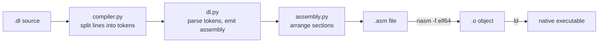

# Dree Lang (`dl`)

A tiny programming language that compiles to **x86-64 NASM assembly**, then to a native Linux executable. The compiler is about 270 lines of Python, which makes it small enough to read in one sitting and learn how a compiler fits together.

```text
printl: "Hello world"
```

```text
$ ./hello
Hello world
```

## Contents

- [How it works](#how-it-works)
- [Requirements](#requirements)
- [Getting started](#getting-started)
- [The language](#the-language)
- [Examples](#examples)
- [Walkthrough: from `.dl` to executable](#walkthrough-from-dl-to-executable)
- [Code tour](#code-tour)
- [Command-line reference](#command-line-reference)
- [Project layout](#project-layout)
- [Known limitations](#known-limitations)

## How it works



1. **Tokenize** each line of the source, keeping quoted strings in one piece.
2. **Parse** the tokens into either a variable declaration or a print statement, and emit assembly for it.
3. **Assemble** the pieces into one `.asm` file with `.bss`, `.data`, `.text` and helper-function sections.
4. **Hand off** to `nasm` and `ld`, which produce the final binary. There is no runtime and no libc, because the output makes raw Linux system calls.

## Requirements

| Tool | Why | Needed for |
| --- | --- | --- |
| `python3` | runs the compiler | everything |
| `nasm` | assembles the generated `.asm` | everything |
| `ld` (binutils) | links the object file | everything |
| `pyinstaller` | bundles the compiler into one binary | `make` only |
| `make` | runs the build | `make` only |

The compiler targets **Linux x86-64** only. It uses Linux syscall numbers and the ELF64 format.

```bash
# Debian / Ubuntu
sudo apt install python3 nasm binutils make
# Void Linux
sudo xbps-install python3 nasm binutils make
# only if you want the standalone binary
pip install pyinstaller
```

## Getting started

```bash
git clone https://github.com/Alpinine99/dree-lang-2-asm.git
cd dree-lang-2-asm
```

### Option 1: run straight from source

```bash
python3 src/compiler.py examples/hello.dl
./hello
```

The executable is written to your **current directory** and named after the source file (`hello.dl` becomes `hello`).

### Option 2: build a standalone compiler with `make`

```bash
make          # builds build/dl-compiler, then compiles every example into build/
./build/hello
make clean    # removes build/
```

`make` bundles the Python sources into a single executable with PyInstaller (`--onefile`), moves it to `build/dl-compiler`, then compiles each `examples/*.dl` file with it. The bundled compiler still calls `nasm` and `ld` at run time, so both must be installed on any machine that uses it.

## The language

A program is a list of lines. Blank lines are ignored. There are only two kinds of statement.

### Variables

```text
name = "Andre"
num = 65536
```

`name` is a string (single or double quotes both work) and `num` is a signed 64-bit integer. The language has no comment syntax, so don't add trailing notes to these lines.

- Strings go in the `.data` section as bytes, plus a `<name>_len` constant holding their length.
- Integers go in `.data` as 8-byte values. Anything above 2⁶³ − 1 is rejected with `invalid variable definition`.

### Printing

| Statement | Behavior |
| --- | --- |
| `print: ...` | prints its arguments, no newline |
| `printl: ...` | prints its arguments, then a newline |

Arguments are separated by spaces and can be:

- a **string literal**: `"Hello "`
- a **variable reference**: `#name`, where the `#` prefix means "insert the value of this variable"

```text
printl: "Hello " #name " Your number is: " #num
```

Referencing a variable that hasn't been declared yet is an error (`Undefined variable 'x'`). Declarations must come before use.

## Examples

All three live in [`examples/`](examples/).

**`hello.dl`**
```text
printl: "Hello world"
```
```text
Hello world
```

**`variables.dl`**
```text
num = 65536
name = "Andre"

printl: "Hello " #name " Your number is: " #num
```
```text
Hello Andre Your number is: 65536
```

**`print-formating.dl`**
```text
temp_sensor = 24
humidity_sensor = 500
water_level_sensor = 70
moisture_sensor = 90

print: "The temperature is: " #temp_sensor "dC | "
print: "The humidity is: " #humidity_sensor "% | "
print: "The water level is: " #water_level_sensor "% | "
printl: "The moisture is: " #moisture_sensor "%"
```
```text
The temperature is: 24dC | The humidity is: 500% | The water level is: 70% | The moisture is: 90%
```
The first three lines use `print:`, so everything lands on one output line. The final `printl:` ends it.

## Walkthrough: from `.dl` to executable

We'll follow `printl: "Hello " #name " Your number is: " #num` from `variables.dl` all the way through. Add `--asm` to keep the intermediate files, and use log level `1` to see the tokens:

```bash
python3 src/compiler.py examples/variables.dl 1 --asm
```

### Step 1: Tokenizing (`compiler.py`)

`perLineToken` splits a line on spaces but **does not split inside quotes**, so `"Hello "` stays one token, trailing space included. Line 4 becomes:

```text
['printl:', '"Hello "', '#name', '" Your number is: "', '#num']
```

An unclosed quote is a hard error: `unmatched quote in at (line N) ...`

### Step 2: Parsing (`dl.py`)

`Dl.parse` tries each rule in order and raises `undefined state` if none matches:

1. `varDec`: is this `name = value`?
2. `print`: does the first token start with `print:` or `printl:`?

**Declarations** emit data. `num = 65536` and `name = "Andre"` become:

```nasm
section .data
num: dq 65536
name: db "Andre"
name_len: equ $ - name        ; assembler computes the length
```

**Print statements** emit code for each argument:

| Argument | What gets emitted |
| --- | --- |
| `"Hello "` | a uniquely named data label (`v4r_1`, `v4r_2`, ...) plus a call to `pstr` |
| `#name` (string) | an inline `write` syscall using `name` and `name_len` |
| `#num` (integer) | load the value into `rax` and `call pnum` |

`pstr` and `pnum` are **helper functions emitted once**, the first time they're needed. A program that never prints a number never gets `pnum` or its buffer.

### Step 3: Assembling (`assembly.py`)

`ASM.write()` stitches the sections together in a fixed order:

```text
global _start
section .bss      (only if something was added)
section .data     (only if something was added)
section .text
_start:           (the program's statements)
exit(0) syscall   (mov rax, 60 / mov rdi, 0 / syscall)
helper functions  (pstr, pnum, placed after the exit so they're never run by falling through)
```

The generated assembly for `variables.dl` is:

```nasm
global _start

section .bss
ibuf: resb 20                    ; scratch space for number-to-text

section .data
num: dq 65536
name: db "Andre"
name_len: equ $ - name
v4r_1: db "Hello "
v4r_1_len: equ $ - v4r_1
v4r_2: db " Your number is: "
v4r_2_len: equ $ - v4r_2

section .text
_start:
mov rsi, v4r_1                   ; print "Hello "
mov rdx, v4r_1_len
call pstr
mov rax, 1                       ; print #name (inline write)
mov rdi, 1
mov rsi, name
mov rdx, name_len
syscall
mov rsi, v4r_2                   ; print " Your number is: "
mov rdx, v4r_2_len
call pstr
mov rax, [num]                   ; print #num
call pnum
mov rax, 1                       ; the newline from printl
mov rdi, 1
mov byte [rsi], 10
mov rdx, 1
syscall
mov rax, 60                      ; exit(0)
mov rdi, 0
syscall

pstr:                            ; write(1, rsi, rdx)
mov rax, 1
mov rdi, 1
syscall
ret

pnum:                            ; see "How numbers are printed" below
...
```

### Step 4: Assemble and link

`compiler.py` writes `variables.asm`, then runs:

```bash
nasm -f elf64 -o variables.o variables.asm
ld -o variables variables.o
```

Without `--asm`, the `.asm` and `.o` files are deleted afterwards. Any `nasm` or `ld` error output is shown as a compiler `ERROR` and the compiler exits with code 1.

### How numbers are printed

The CPU has no "print integer" instruction, so `pnum` converts the number to text by hand:

1. Point `rcx` at the **end** of the 20-byte `ibuf`.
2. Divide the number by 10 with `div`. The remainder (`rdx`) is the last digit, and the quotient is what's left.
3. Add `'0'` to turn the digit 0-9 into its ASCII character, step `rcx` back one byte, and store it.
4. Repeat until the quotient is 0. Digits are produced **right to left**, which is why the buffer is filled backwards.
5. The text now sits between `rcx` and the buffer end. Its length is `ibuf + 20 - rcx`, and one `write` syscall prints it.

## Code tour

### `src/compiler.py`: the driver

| Piece | Role |
| --- | --- |
| `LOG(level, *msg)` | levelled logging. Level 4 (`ERROR`) prints and exits with status 1 |
| `perLineToken` | quote-aware tokenizer for a single line |
| `rewrite(file)` | reads the file, feeds each non-blank line to a `Dl` instance, and wraps parser errors with the line number |
| `main()` | parses CLI arguments, writes the `.asm` file, runs `nasm`, then `ld`, then cleans up |

### `src/dl.py`: the language

The `Dl` class holds everything the compiler needs to remember while reading a program:

| Field | Purpose |
| --- | --- |
| `_asm` | the `ASM` object that collects output |
| `_defined_vars` | `(name, type)` pairs, so `#name` knows whether to print as a string or a number |
| `_var` | counter behind the `v4r_N` labels for string literals |
| `_hasPrintFunc`, `_hasNumPrintFunc`, `_intBufReserved` | "already emitted?" flags for the helper functions and the buffer |

Methods: `varDec` (declarations), `print` (both print forms), `printFunc` / `numPrintFunc` / `resvIntBuf` (lazy emitters), `getVar` (unique labels), `parse` (dispatcher), `write` (returns the finished assembly).

Adding a new statement means adding a rule to `parse` and a method that appends to `self._asm.section.*`.

### `src/assembly.py`: the output container

`ASM` owns four `InnerSec` sections (`bss`, `data`, `text`, `funcs`). Each is a string builder with an `edited` flag, so empty sections are left out of the output.

## Command-line reference

```text
dl-compiler <path/to/file.dl> [log level 1-4] [--asm]
```

| Argument | Meaning |
| --- | --- |
| `file.dl` | source file (required) |
| log level | `1` DEBUG (prints tokens for each line), `2` INFO (default), `3` WARNING, `4` ERROR only |
| `--asm` | keep `<name>.asm` and `<name>.o`. It must come **after** the log level, so pass one (e.g. `2`) to use it |

Output: an executable called `<name>` in the current directory.

## Project layout

```text
dree-lang/
├── src/
│   ├── compiler.py     # CLI, tokenizer, nasm/ld driver
│   ├── dl.py           # parser and code generator
│   └── assembly.py     # section builder
├── examples/
│   ├── hello.dl
│   ├── variables.dl
│   └── print-formating.dl
├── makefile            # PyInstaller build + compiles the examples
└── .gitignore
```

## Known limitations

This is an early version. These behaviors are real, found by running the compiler, and are good first things to fix:

- **`printl` overwrites the first byte of whatever it printed last.** It writes the newline with `mov byte [rsi], 10`, and `rsi` still points at the last string or variable. Printing the same variable twice shows it:
  ```text
  name = "Andre"
  printl: #name
  printl: #name
  ```
  prints `Andre`, then an empty line, then `ndre`. The first `printl` turns the `A` of `name` into a newline byte, so the second one prints that newline followed by `ndre`. Fix: put a dedicated `nl: db 10` in `.data` and point `rsi` at that.
- **Negative integers print wrong.** `n = -5` prints `18446744073709551611`, because `pnum` divides unsigned. There is also no lower-bound check.
- **No escape sequences.** `"a\nb"` prints a literal backslash followed by `n`, since NASM doesn't process escapes in double-quoted strings. Use `printl:` for newlines.
- **No comments.** A line starting with `#` fails with `undefined state`.
- **Variables can't be reassigned.** A second `x = 2` produces a NASM error (`label inconsistently redefined`).
- **Only literals and `#variables` as print arguments.** There are no expressions, input, conditionals or loops yet.
- **Linux x86-64 only**, and it needs `nasm` and `ld` installed.
- There is no automated test suite. The examples are the tests for now.
